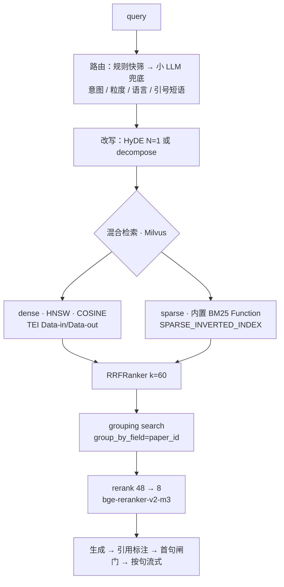

# CiteQuest

面向计算机论文的混合检索与可溯源 RAG 系统，覆盖约 27 万篇 / 147 万 chunk 的全文与摘要双层语料。


[](docs/)

## 它解决什么问题

学术检索有两个各自独立、又必须一起解决的问题。一个是**召回**：关键词检索找不到换了说法的同一件事，
纯语义检索又会把精确的术语、模型名、数据集名糊掉。另一个是**可信**：让 LLM 直接回答文献问题，
生成的句子看上去合理，但用户没有办法核对它到底出自哪一篇、哪一节。

CiteQuest 把这两件事做成同一条链路。检索侧是 dense 与 BM25 双路召回 + RRF 融合 + cross-encoder 精排，
结果在服务端按论文聚合而不是按 chunk 罗列；生成侧的每一句话都沿**已声明的 `[N]` 引用边**做校验，
引用锚点细化到 `(paper_id, section, sec_number, paragraph_idx)`。流式回答的首句阻塞过闸，
过闸之后按句推送、只降级不撤回——因为 token 一旦出网就收不回来，「不合格不展示」只有在第一个 token 出网前可执行。

## 架构



搜索路在 `grouping` 之后直出（60 组 × 1，不走 rerank 与生成）；RAG 路取 16 组 × 3 ≤ 48 chunk 后进精排。
编排主体是 **workflow（routing + parallelization）**，控制流写死在代码里；
全系统只有一条由模型决定下一步的循环——`graph/` 里的检索纠正循环，`recursion_limit=8`，循环上限 1 次。
分层架构详见 [docs/architecture.md](docs/architecture.md)。

延迟目标（搜索路首字节 p50 ≤ 100 ms、RAG 路首 token p50 ≤ 1.0 s）是**设计预算，非实测**，
用于告警阈值与回归基线，不作对外性能宣称。

## 接口形态

检索（下面两段是**响应形态示例**，字段值均为示意；其中 `took_ms` 是占位值，不是实测延迟）：

```console
$ curl -s 'http://localhost:8080/v1/search?q=rotary+position+embedding&page_size=2' | jq
{
  "meta": {
    "request_id": "01JBK8...",
    "index_version": "idx_20260813_01",
    "retrieval_mode": "hybrid",
    "took_ms": 78,
    "cache": "miss",
    "degraded": []
  },
  "results": {
    "group_count": 60,
    "page": 1,
    "page_size": 2,
    "papers": [
      {
        "paper_id": "W3118375032",
        "title": "RoFormer: Enhanced Transformer with Rotary Position Embedding",
        "year": 2021,
        "primary_category": "cs.CL",
        "granularity": "fulltext",
        "has_fulltext": true,
        "best_chunk": {
          "chunk_id": "W3118375032#c07",
          "section": "Proposed approach",
          "sec_number": "3",
          "paragraph_idx": 2,
          "text": "We propose Rotary Position Embedding (RoPE), which encodes ..."
        },
        "license": "CC-BY-SA-4.0",
        "source_dataset": "unarXive_open_subset",
        "attribution": {
          "text": "unarXive open subset (Saier et al., JCDL 2023), CC BY-SA 4.0",
          "source_url": "https://doi.org/10.5281/zenodo.7752615",
          "original_url": "https://arxiv.org/abs/2104.09864"
        }
      }
    ]
  }
}
```

带引用的流式回答（SSE，整条流永远是 HTTP 200，失败以事件下发）：

```console
$ curl -N 'http://localhost:8080/v1/answer?q=how+does+RoPE+encode+relative+position&language=EN'
event: meta
data: {"request_id":"01JBK8...","index_version":"idx_20260813_01","route":"pending"}

event: search_results
data: {"group_count":16,"retrieval_mode":"hybrid","papers":[...]}

event: ai_answer_start
data: {"sources":[{"citation_id":1,"paper_id":"W3118375032","title":"RoFormer: ...",
       "year":2021,"granularity":"fulltext","section":"Proposed approach","sec_number":"3"}],
       "pipeline":"search_plus_qa","answer_state":"normal"}

event: ai_answer_delta
data: {"seq":1,"text":"RoPE multiplies the query and key vectors by a rotation matrix
       whose angle depends on the absolute position [1].","citations":[1]}

event: ai_answer_done
data: {"sentence_count":4,"citation_support":[{"seq":1,"strength":"supported"}],"degraded":[]}
```

`ai_answer_start` 出现，即意味着首句已通过 grounding 闸门；没有它而直接收到 `ai_answer_error`，
意味着首句没过闸、系统选择完全不进流式——此时一个 token 都没有推送出去。

## 快速上手

**前置条件**：Docker Engine 24+ 与 Docker Compose v2；Python 3.12+ 与 [uv](https://docs.astral.sh/uv/)；
一块 compute capability ≥ 7.5 的 NVIDIA GPU（TEI 的硬性下限，V100 / GTX 10 系不支持）与 NVIDIA Container Toolkit；
磁盘至少 60 GB（unarXive 原始包 4.8 GB + 解压 + 索引）。

```bash
# 1. 依赖（同时装好 pre-commit 钩子）。首次执行会解析出 uv.lock，
#    之后把它提交进版本库——CI 与镜像构建用的是 uv sync --frozen，只认锁文件
make install

# 2. 起 Milvus 2.6 standalone + TEI
#    TEI 镜像 tag 必须匹配本机 GPU 架构（默认 89 = Ada Lovelace / RTX 4000 系），
#    改在 docker/.env 里，见 docker/tei/README.md
cp docker/.env.example docker/.env
make up

# 3. 核对当前生效的参数，确认没有环境变量意外覆盖设计值
uv run citequest show-config

# 4. 建库。先跑 dry-run：它只做 schema 校验与规模估算，不写入
uv run citequest build-index --dry-run

#    想先跑通链路，只灌摘要层（约 22 万 chunk，分钟到小时量级）：
uv run citequest build-index --granularity abstract
#    全量两层（约 147 万 chunk）是 6–10 小时量级：
uv run citequest build-index

# 5. 起服务（开发模式带热重载）
make serve
```

服务起来之后，用上一节的两条 `curl` 验证；OpenAPI 文档在 `http://localhost:8080/docs`。
接 Claude Desktop 之类的 MCP 宿主用 `make mcp`（stdio 传输）。

提交前的质量门是 `make check`（ruff + mypy + 单元测试），与 CI 跑的是同一套。

## 核心能力

- **双路召回单一融合**：dense（BGE-M3 / HNSW / COSINE）与 sparse（Milvus 内置 BM25 Function）并行召回，
  唯一融合器 `RRFRanker(k=60)`；需要通道偏置的场景改为单路不融合，而不是引入加权器。
- **论文级聚合在服务端完成**：Milvus 原生 grouping search 按 `paper_id` 分组，
  搜索路 60 组 × 1、RAG 路 16 组 × 3，避免同一篇论文刷屏，也不需要靠过采样凑组数。
- **术语精确匹配**：独立的 `text_exact` 字段支持 `TEXT_MATCH` 布尔过滤与 `PHRASE_MATCH(slop)` 短语邻近，
  带引号的确切短语走 sparse 单路，BM25 分数直接作为排序依据。
- **粒度是接口字段而非免责声明**：`granularity` 逐条下发并可作为请求参数，
  方法级问题强制走全文层——不做这个分支，模型会拿 2024 年的摘要编出一个听起来合理的损失函数。
- **逐引用边的 grounding**：沿已声明的 `[N]` 引用边判定，不对全部 chunk 取最大相似度；
  硬拦截只用确定性字符串校验（`[N]` 越界 / 引用全部非法），模型判定只降级不拦截。
- **首句闸门 + 按句流式**：首句阻塞校验，过闸才发 `ai_answer_start`；之后按句边界推送，先推后标、只降级不撤回。
- **逐条许可与署名**：每条结果带 `license` / `source_dataset` / `attribution`，两层语料许可不同，不做全局混合声明。
- **两个协议入口共用一个 service 层**：HTTP（FastAPI + SSE）与 MCP（官方 Python SDK，stdio，5 个只读幂等工具）
  调的是同一份 `pipelines/`，不是两套业务逻辑。

## 技术栈

| 组件 | 选型 | 承担什么 |
|---|---|---|
| 向量库 | Milvus 2.6.x | dense HNSW + sparse BM25 同库同一次查询、标量过滤、grouping search |
| dense 编码 | TEI 官方镜像 + Milvus TEI Embedding Function | Data-in/Data-out，**没有任何自写推理服务** |
| 嵌入模型 | BAAI/bge-m3（1024 维） | dense 通道；sparse 由 Milvus 内置 BM25 承担 |
| 精排 | BAAI/bge-reranker-v2-m3 | 应用侧 cross-encoder，48 → 8，`normalize=True` |
| 幻觉软信号 | vectara/HHEM-2.1-Open | 在线只在首句跑一次，只降级不拦截 |
| 服务层 | FastAPI + sse-starlette | REST + SSE 流式 |
| 编排 | LangGraph（仅检索纠正循环） | 主体是 workflow，循环只有一条且有硬上限 |
| 工具协议 | MCP Python SDK（stdio） | 5 个只读幂等工具 |
| 配置 | pydantic-settings | 参数正本在代码里，环境变量只覆盖部署差异 |
| 评测 | ranx + datasets | 显著性检验、消融、离线 A/B |

## 关键设计决策

每条只给结论，展开见 [docs/architecture.md](docs/architecture.md)。

| 决策 | 为什么 |
|---|---|
| sparse 用 Milvus 内置 BM25 Function，不做 learned sparse | Milvus Embedding Function 的输出类型限定 `FLOAT_VECTOR` / `INT8_VECTOR`，走 SPLADE 就必须退回客户端编码胶水，放弃 Data-in/Data-out 的全部收益 |
| dense 编码走 TEI + Milvus Function，不自建推理服务 | 灌库与查询共用同一份 schema 级声明，「离线用 A 模型、在线用 B 模型」这类不一致在结构上不可能发生 |
| 融合器唯一 `RRFRanker(k=60)`，删除 WeightedRanker | COSINE 有界而 BM25 无上界，且混合粒度语料让两层分数分布本就不同；RRF 用名次替代分数，一次消掉两个来源的不可比 |
| RRF 分数不得用作阈值 | k=60 时上界约 0.033，无物理含义。全系统唯一可做阈值的是 rerank 的归一化分——响应模型里干脆没有 `rrf_score` 字段 |
| rerank 放应用侧，不用 Milvus Model Ranker | 官方限制「Model rankers cannot be used with grouping searches」。两个官方能力互斥时选 grouping，因为论文级聚合是产品必需 |
| 主体是 workflow，只留一条窄的 LangGraph 循环 | `recursion_limit` 是框架强制的，而自由 ReAct 的轮数上限只能靠 prompt 请模型自觉 |
| 占位符进索引前删除而非替换成被引标题 | 替换等于把 unarXive_citrec 的 label 泄漏进索引文本，头条基准当场作废；同时避免几十万个 uuid 垃圾 token 污染 `avgdl` |

## 数据与许可

语料分两层，各自对应一种能力：

| 层 | 来源 | 范围 | 规模 | 许可 |
|---|---|---|---|---|
| 全文 `granularity=fulltext` | [unarXive open subset](https://doi.org/10.5281/zenodo.7752615) | `cs.*`，2019–2022，含 section 结构 | 5 万篇 | [CC-BY-SA-4.0](https://creativecommons.org/licenses/by-sa/4.0/) |
| 摘要 `granularity=abstract` | [OpenAlex](https://openalex.org/) | Computer Science，2023–2025 | 219,676 篇 | [CC0](https://creativecommons.org/publicdomain/zero/1.0/) |

合计约 27 万篇 / 约 147 万 chunk。全文层按 section 边界聚合段落到 450 token；摘要层每篇 1 chunk。

**代码许可与数据许可是两件事，必须分开看**：

- 本仓库的代码为 Apache-2.0。代码不是从语料派生的作品，CC-BY-SA 的 ShareAlike 传染不到它。
- **本仓库不分发任何语料原文、处理后的 chunk、向量文件或 Milvus collection 快照**，只提供构建脚本。
  `samples/` 目录下如放置少量样例，该目录单独标注上游许可与署名，用目录隔离防止 CC0 层被 SA 传染。
- 在线返回检索片段属于许可意义上的分发，因此每条结果都带 `license` / `source_dataset` / `attribution`
  三个字段逐条署名——汇编（Collection）不是改编（Adaptation），一句全局混合声明不成立。

以上是基于许可正文的保守工程做法，不构成法律意见。

## 评测方法

两层语料各自对应一个公开基准，**分粒度报告，禁止合并成一个数字**——22 万条摘要会把 5 万篇全文的表现稀释掉。

| | 基准 | 覆盖 | 指标 |
|---|---|---|---|
| 头条 | [unarXive_citrec](https://huggingface.co/datasets/saier/unarXive_citrec) test split 的库内子集 | 全文层，段落级 | Recall@100 / MRR@10 |
| 第二 | [LitSearch](https://github.com/princeton-nlp/LitSearch)（597 query / 64,183 corpus） | 摘要层，title+abstract | nDCG@10 / Recall@5,20,100 |

口径写在报告里，不写在脚注里：按 query 平均（macro）；qrels 天然二值；
**必报过滤率**（citrec 的 label 落在本库内的比例）——这是证据链不是遮掩；
**必报 per-query win/loss/tie**——均值相同可能是「全面小赢」也可能是「大赢大输相抵」；
**显式声明评测用的是加大的 `group_limit=100`**（线上 60）；
不报 LitSearch 的 Precision@10，因为它平均每 query 只有 1.07 个相关文档，该指标上限只有 0.1 左右。
显著性用配对 t 与 Fisher randomization 双跑，不一致以 randomization 为准，多重比较用 Tukey HSD。

```bash
uv run --group eval citequest evaluate --benchmark litsearch --config hybrid_rerank
uv run --group eval citequest evaluate --benchmark citrec   --config hybrid
```

报告落到 `reports/`，含均值、bootstrap 95% CI、per-query 三元计数与配置快照。
消融档位共四档（`bm25_only` / `dense_only` / `hybrid` / `hybrid_rerank`），共用同一份 query、qrels 与代码，一次只变一项。

两条**事先写死的止损判据**：HyDE 跑不赢 direct 就下线；纠正循环相对静态 pipeline 提升 < 5% 就砍掉循环。

> **本仓库不公布未实测的性能数字。** README 与设计文档里出现的所有延迟均为设计预算，
> 配置项 `latency_budget.measured` 为 `False` 时禁止在任何对外材料中引用具体毫秒数。
> 评测脚本、口径与消融配置全部开源，任何人可以自行复现。

## API 与 MCP 工具

| 端点 | 方法 | 说明 |
|---|---|---|
| `/v1/search` | GET | 纯检索，无 LLM、无 rerank、无 grounding 闸门 |
| `/v1/answer` | GET | 带引用的 RAG 回答，SSE 流式 |
| `/v1/papers/{paper_id}` | GET | 单篇详情：元数据 + 库内 chunk 列表 |
| `/v1/facets` | GET | 全库精确聚合（与结果集内近似分布是两个字段，契约层就拆开） |
| `/v1/feedback` | POST | 结果反馈 |
| `/healthz` `/readyz` | GET | 存活与就绪探针 |

5 个只读幂等 MCP 工具（`citequest mcp`，stdio）：

| 工具 | 用途 |
|---|---|
| `search_papers` | 发现 / 定位：这个方向有哪些工作（paper 级） |
| `search_chunks` | 取可直接引用的证据（chunk 级，最贵，配额最紧） |
| `get_paper_detail` | 单篇元数据、署名与库内 chunk 列表 |
| `structured_filter` | 纯结构化筛选：年份 / 类目 / 粒度 |
| `expand_by_citation` | 引用**上下文**检索：别人在什么语境下引用 X |

工具全部只读、幂等、无副作用，因此不需要审批断点。完整 schema 见 `http://localhost:8080/docs` 与 `src/citequest/orchestration/tool_specs.py`。

## 配置

参数正本在 `src/citequest/config/`，环境变量只覆盖部署差异（地址、密钥、开关），**不用来改设计参数**。
写法为前缀 `CITEQUEST_` + 双下划线表示嵌套；完整清单见 [docs/configuration.md](docs/configuration.md)，
样例见 [.env.example](.env.example)。最常改的几项：

| 环境变量 | 默认值 | 说明 |
|---|---|---|
| `CITEQUEST_MILVUS__URI` | `http://localhost:19530` | Milvus 地址 |
| `CITEQUEST_MILVUS__INDEX_VERSION` | `idx_00000000_00` | 进响应体与缓存 key，换它即一键全量缓存失效 |
| `CITEQUEST_EMBEDDING__ENDPOINT` | `http://tei:80` | TEI 地址。**填的是 Milvus 容器视角的地址**，不是本进程视角 |
| `CITEQUEST_GENERATION__BASE_URL` | `http://localhost:8000/v1` | 生成模型的 OpenAI 兼容端点 |
| `CITEQUEST_REWRITE__HYDE_ENABLED` | `true` | HyDE 开关，带存活条件 |
| `CITEQUEST_API__PORT` | `8080` | HTTP 端口 |
| `CITEQUEST_LOG_FORMAT` | `json` | 容器里用 `json`，本地开发用 `console` |

## 项目结构

```
src/citequest/
  config/        参数正本。每个设计数值在这里有且只有一份默认值
  core/          领域层：枚举、数据契约、异常。不依赖任何外部服务
  observability/ 结构化日志、request_id 注入、span、成本与坏例记录
  ingestion/     语料获取、清洗与切块（unarxive / openalex）
  indexing/      Milvus schema、Function 声明、索引参数、灌库
  retrieval/     混合检索、RRF、精确匹配、grouping、rerank、分面
  query/         路由、意图与粒度判定、HyDE、decompose
  rag/           生成、引用、grounding、按句流式（prompts/ 单独成包）
  graph/         唯一的 LangGraph 部分：检索纠正循环
  orchestration/ 工具定义与注册表、会话记忆、冲突检测
  pipelines/     workflow 编排，HTTP 与 MCP 共用的 service 层
  llm/           外部模型客户端封装（没有 embedding 客户端，见「技术栈」）
  api/           FastAPI 薄层：routes / schemas / deps / errors / sse
  mcp_server/    MCP server（命名带 _server 是为了与 pip 包 mcp 区分）
  evaluation/    评测一等模块：datasets / metrics / runners / 消融与校准
docker/          Milvus + TEI + API 的 compose 编排与镜像
scripts/         薄壳脚本，不装包也能跑一次
tests/           unit（不连外部服务）/ integration（需 Milvus+TEI）/ e2e（TestClient）
```

依赖方向单向：`core` 与 `config` 不 import 任何上层；`api` 与 `mcp_server` 只 import `pipelines`，
不直接碰 `retrieval` 与 `rag`。`tests/unit/test_settings_defaults.py` 拦的就是「设计参数被悄悄改掉」这件事。

## 设计边界与不做的事

这些是主动的工程判断，不是缺口：

- **不自建推理服务**。dense 编码走 TEI + Milvus Function 的 Data-in/Data-out，全系统没有一行自写推理代码。
- **不做在线 A/B**。零真实流量下「>1000 请求/组、7 天周期」无法执行，改用 ranx 离线对照与消融。
- **不做引用图遍历**。摘要层的引用关系字段在实测中大面积为空，因此只做引用**上下文**检索——
  能回答「谁在什么语境下引用了 X」，不回答「X 引了谁、引用链多深」。
- **不做多模态**。图表与公式内容不进检索通道，公式 LaTeX 保留在不参与检索的 metadata 字段。
- **不引入 Elasticsearch / Postgres**。精确匹配用 Milvus 的 `TEXT_MATCH` / `PHRASE_MATCH`，
  全库精确分面用 DuckDB 读 parquet，不新增有状态服务。
- **不把系统称作 agent**。主体是 workflow；唯一的循环有 `recursion_limit=8` 与 1 次上限的硬约束。
- **不展示自造的可信度分数**。支持强度只用来把弱支持的句子标灰，不换算成「87 分可信度」——
  那个数字没有校准依据。未标定的阈值一律取 `None`，对应取值是 `unverified`，而 `unverified` 是诚实取值不是失败。

## 文档

| 文档 | 内容 |
|---|---|
| [docs/architecture.md](docs/architecture.md) | 分层架构、数据流、每层的关键决策与取舍，以及 9 份完整设计文档的索引 |
| [docs/configuration.md](docs/configuration.md) | 全部配置项：参数、默认值、依据、可否在建库后修改 |
| [docs/development.md](docs/development.md) | 本地开发、测试分层、代码规范，以及如何新增一个检索策略或一个 MCP 工具 |
| [CONTRIBUTING.md](CONTRIBUTING.md) | 提问、报告问题与提交改动的方式 |
| [CHANGELOG.md](CHANGELOG.md) | 版本变更记录（Keep a Changelog） |

## 致谢与上游引用

本项目建立在下列公开工作之上：

- **unarXive** — Saier et al., *unarXive 2022: All arXiv Publications Pre-Processed for NLP*, JCDL 2023
  （[arXiv:2303.14957](https://arxiv.org/abs/2303.14957)，[Zenodo DOI 10.5281/zenodo.7752615](https://doi.org/10.5281/zenodo.7752615)）
- **OpenAlex** — Priem et al., *OpenAlex: A fully-open index of scholarly works, authors, venues, institutions, and concepts*
  （[arXiv:2205.01833](https://arxiv.org/abs/2205.01833)）
- **BGE-M3** — Chen et al., *BGE M3-Embedding: Multi-Lingual, Multi-Functionality, Multi-Granularity Text Embeddings*
  （[arXiv:2402.03216](https://arxiv.org/abs/2402.03216)）与 [bge-reranker-v2-m3](https://huggingface.co/BAAI/bge-reranker-v2-m3)
- **LitSearch** — Ajith et al., *LitSearch: A Retrieval Benchmark for Scientific Literature Search*
  （[arXiv:2407.18940](https://arxiv.org/abs/2407.18940)）
- **HHEM-2.1-Open** — Vectara, [hallucination_evaluation_model](https://huggingface.co/vectara/hallucination_evaluation_model)
- **HyDE** — Gao et al., *Precise Zero-Shot Dense Retrieval without Relevance Labels*（[arXiv:2212.10496](https://arxiv.org/abs/2212.10496)）
- **RRF** — Cormack et al., *Reciprocal Rank Fusion outperforms Condorcet and individual Rank Learning Methods*, SIGIR 2009
- **Milvus** — Wang et al., *Milvus: A Purpose-Built Vector Data Management System*, SIGMOD 2021；
  以及 [Text Embeddings Inference](https://github.com/huggingface/text-embeddings-inference) 与
  [Model Context Protocol](https://github.com/modelcontextprotocol/python-sdk)

## 参与与反馈

CiteQuest 由个人维护。用法问题、复现失败与对某个设计决策的疑问，请走 GitHub Issues
（附上 `citequest show-config` 的输出与日志里的 `request_id`）。

**接受 Pull Request。** 提交前请读 [CONTRIBUTING.md](CONTRIBUTING.md)：那里写了质量门
（`make check`）、几条不可动的架构约束，以及哪些改动需要先开 Issue 讨论。

## License

代码以 [Apache-2.0](LICENSE) 授权，SPDX 标识 `Apache-2.0`，版权归 CiteQuest 作者所有。

**语料许可与代码许可不同，见「数据与许可」一节**：unarXive 全文层为 CC-BY-SA-4.0，OpenAlex 摘要层为 CC0；
本仓库不分发语料原文，只提供构建脚本。
