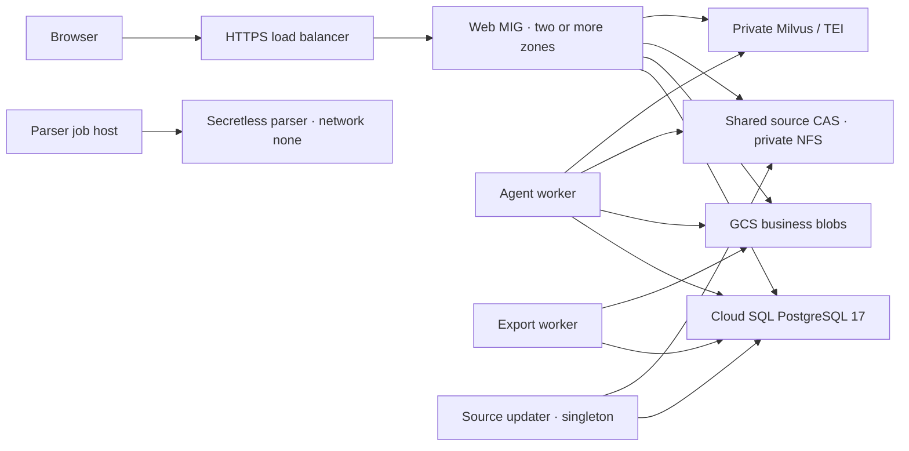

# CiteQuest on Google Cloud

Regional Web/API deployment with separate Agent, source updater, export worker and parser job hosts.



The module consumes [`foundation_contract`](../foundation/) and adds private COS VMs, Cloud NAT, a regional Web MIG, readiness/liveness checks, HTTP-to-HTTPS redirection and a managed TLS certificate. Web updates retain all existing capacity while adding one surge instance per zone, then drain old connections for 300 seconds.

## Releases

| Role | Image recipe / target | Dependency lock | Runtime |
| --- | --- | --- | --- |
| Web | `deploy/core/Dockerfile`, `web` | `runtime/server-web` | Web/API on port 8080 |
| Agent | `deploy/core/Dockerfile`, `agent` | `runtime/server-agent` | Durable consumer with `--drain-on-signal` |
| Updater | `deploy/core/Dockerfile`, `updater` | `runtime/server-indexer` | `python -m citequest.updates_v2.broker --config /run/citequest/config/source-broker.json` |
| Indexer | `deploy/core/Dockerfile`, `indexer` | `runtime/server-indexer` | Controlled index preparation/publication jobs |
| Export | `deploy/core/Dockerfile`, `export_worker` | `runtime/server-agent` | `citequest.exports_v3.cli --serve` |
| Parser | `runtime/s04-linux/Dockerfile` | `runtime/s04-linux` | One fixed request per isolated child |

Each role directory provides its own `uv.lock` and hash-pinned `requirements.txt` for Linux builds. The three `runtime/server-*` locks supply the Web, Agent/export and source/index roles; `server-web` and `server-agent` include the official `google-cloud-storage==3.17.1` SDK for GCS business/artifact access. The indexer target supplies an explicit job image; this module's continuous source polling runs in the singleton updater, while Milvus/TEI remain external services.

Pin every role image to its registry `@sha256:` digest and COS to a specific image name. Supply verified digests for the official Google Cloud CLI helper and Cloud SQL Auth Proxy **2.27.0**.

Upload configuration, tokenizer and release artifacts to a private config bucket. Every `config_files` entry names an exact GCS object generation and SHA-256 checksum. Include all files referenced transitively by the role config. Bootstrap verifies all bytes before starting an application. Configs mount at both `/run/core-config` and `/run/citequest/config`; secret files mount at the corresponding `secrets` paths and `/run/secrets`.

Start Web configuration from [`web.gcp.example.json`](../../core/config/web.gcp.example.json), fill in the HTTPS origin, OIDC settings and secret-file references, then publish it as the `web.json` artifact in `roles.web.config_files`. Its `trusted_proxy_networks` explicitly contains Google's GFE ranges, `35.191.0.0/16` and `130.211.0.0/22`, matching the ingress firewall. Web accepts forwarded HTTPS/client information only from peers in that list; an empty list keeps proxy trust disabled. The load balancer checks `/readyz` for database/schema readiness, and MIG autohealing checks `/healthz` for process liveness.

Use the foundation's pinned Secret Manager version references in `secret_files`. The VM obtains them with its metadata identity and writes mode-0400 runtime files. Preserve separate business, checkpoint and memory DSN files and their database roles. Point DSNs at `127.0.0.1:5432`; Cloud SQL Auth Proxy encrypts the private-IP connection upstream. The module provides transport access; SQL migrations and least-privilege schema grants use the application's controlled database bootstrap.

Configure private Milvus/TEI endpoints in `search.json`. Use `backend: "gcs"` and `mode: "cloud"` for business/artifact storage, with the foundation bucket and metadata credentials. The current source-search CAS uses its existing POSIX layout: supply an existing private NFSv4.1 share, with UID/GID 10001 access. This shared source CAS mounts at `/opt/citequest/data/runtime-v2-app/blobs`; Agent and export readers mount it read-only. It is separate from GCS business blobs.

Export releases include the checksummed CI `renderer-image.tar` under `export-release/` plus the exact Docker image ID from that release. Bootstrap loads the archive and checks the image ID. `/run/export-release` contains the release files. The dedicated trusted export VM supplies Docker CLI/socket access; renderer children retain their fixed offline sandbox. Set both `worker_spool` and artifact-store spool under `/var/lib/citequest/state`, and `docker_config` to `/var/lib/citequest/state/renderer-docker-config`. The worker spool has the same absolute host/container path so daemon bind mounts resolve correctly. To enable the Web export API, add its certified release files (profile, identity, certification and assets) under Web `config_files.export-release/`, and reference `export-api.json` from `web.json`. Give API and worker the same GCS artifact-store identity. Web's `/var/lib/citequest/state` is temporary spool space; durable artifacts use GCS.

## Deploy

Use Terraform **1.17.1**, the checked-in Google provider **8.10.0** lock, an existing project, and an authenticated deployment identity. Enable the required Compute, IAM, Artifact Registry, Secret Manager, Storage and Cloud SQL APIs in the project. Configure a protected remote state backend for the environment before applying either module.

1. Deploy the [foundation](../foundation/README.md), then export its non-secret contract:

   ```bash
   terraform -chdir=../foundation output -json foundation_contract \
     | jq '{foundation: .}' > foundation.auto.tfvars.json
   ```

2. Copy `terraform.tfvars.example.json` to `terraform.tfvars.json`. Fill in real image digests, object generations/checksums, role configs, existing NFS address and public DNS names. Select at least two zones and at least one Web replica per zone. For new blank persistent disks, explicitly set `initialize_blank_state_disks: true` for the first boot; restore it to `false` after initialization. Existing filesystems are never reformatted.

3. Initialize, review and apply the deployment:

   ```bash
   terraform init -lockfile=readonly
   terraform fmt -check
   terraform validate
   terraform plan -var-file=terraform.tfvars.json -out=workloads.tfplan
   terraform apply workloads.tfplan
   terraform output -json workload_contract
   ```

4. Point the domains' A records to `workload_contract.https.address`. Wait for the managed certificate to become active and the load balancer's readiness checks to become healthy. Configure the OIDC client redirect URI and Web origin for the same HTTPS domain.

No VM receives a public IP. Cloud NAT supplies private-VM egress; the Web ingress firewall accepts port 8080 only from Google's load-balancer/health-check ranges. Use OS Login and the organization's approved private administration path for operations.

## Worker operations

Agent, updater, parser and export hosts have persistent disks and deletion protection. Terraform cannot automatically stop or replace them. Updating worker metadata stages the next boot's release; Web remains independently eligible for rolling updates.

For a planned worker release, stop `citequest-role.service`, observe the worker drain and reconcile its active jobs before a controlled reboot. Worker `docker stop --time=-1` waits for the process to exit; systemd has no forced-stop timeout. Agent finishes its active graph, export finishes the current render, and the source broker stops admission while retaining its SQL journal. Host failure still requires lease/journal reconciliation. Keep source-broker lock/temp state at `/var/lib/citequest/state/source-broker`; source bodies remain in the shared CAS.

The parser host preloads the immutable parser image and prepares its persistent job disk. Dispatch uses the existing fixed one-File trusted broker and execution profile. Each parser child has no network, cloud credentials, database credentials, model keys or Docker socket. Persist exchanges and Docker-operation journals on the state disk; reconcile physical termination before releasing ownership. An old consumed exchange is not replayed after restart.

## References

- [COS cloud-init and systemd containers](https://docs.cloud.google.com/container-optimized-os/docs/how-to/run-container-instance)
- [Regional MIG rollout rules](https://docs.cloud.google.com/compute/docs/instance-groups/rolling-out-updates-to-managed-instance-groups)
- [Cloud SQL Auth Proxy](https://docs.cloud.google.com/sql/docs/postgres/connect-auth-proxy)
