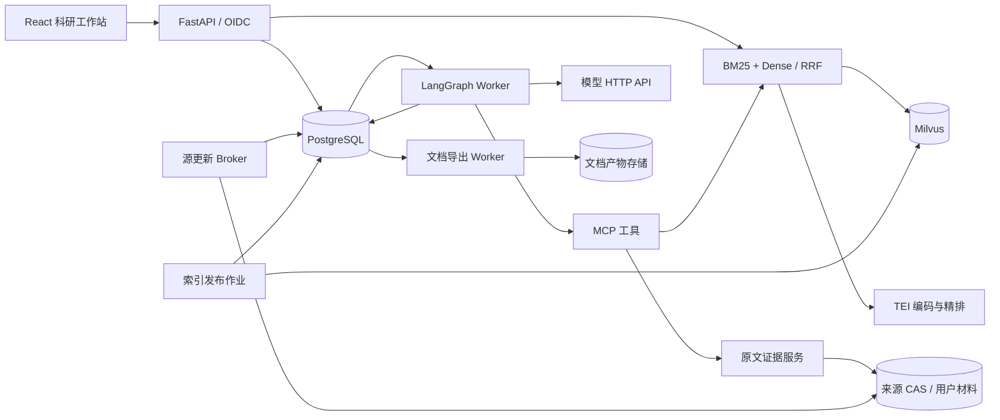
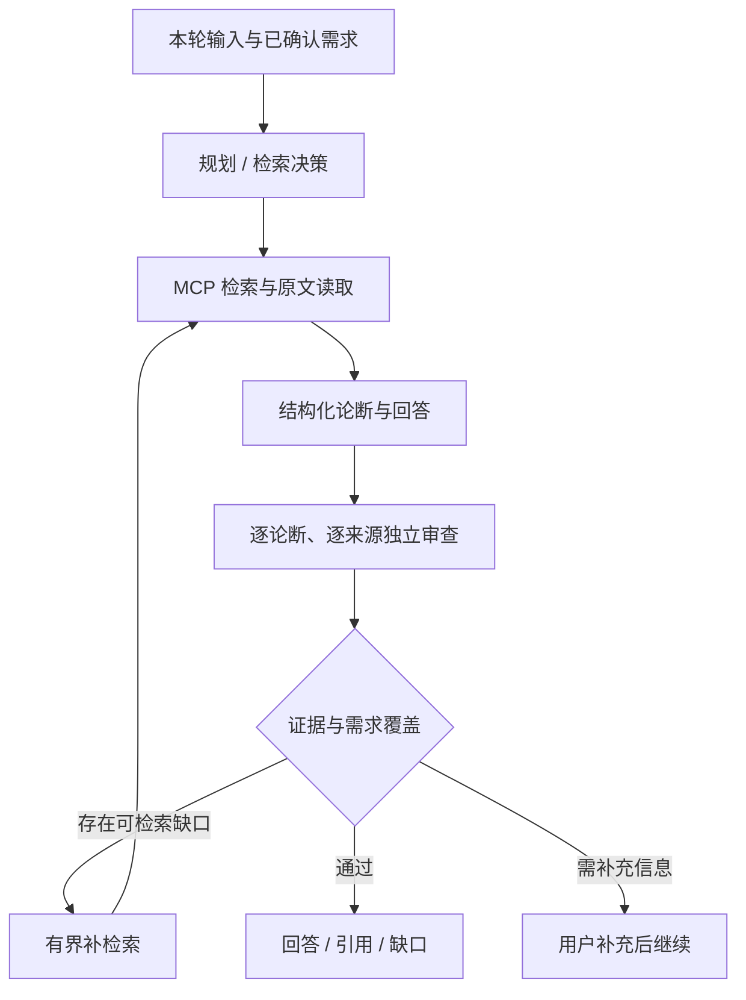

# 架构

CiteQuest 将学术搜索、原文证据与科研 Agent 工作流连接在同一研究空间中。Web/API、Agent、源更新、索引发布和文档渲染分别运行，通过版本化协议与持久状态协作。

## 服务拓扑

| 模块 | 职责 |
| --- | --- |
| `web_v3` | HTTP 接口、身份认证、会话与服务装配 |
| `agents_v3` | LangGraph、模型适配、工具、账本、上下文与记忆 |
| `research_v3` | 科研档案、论断、学校模板、审查和 DecisionRAG |
| `search_v3`、`index_v2`、`index_v3` | 查询、原生索引、固定版本检索与发布 |
| `materials_v2`、`material_evidence_v3` | 上传、Docling 解析与材料证据 |
| `updates_v2` | 公开源观察、HTTP journal、OAI 游标和元数据发布 |
| `exports_v3` | 版本绑定的文档任务、渲染和下载 |
| `skills_v3`、`workstation_v3` | Skill、个人文献、历史与研究档案 |
| `evaluation` | 真实执行轨迹导出与 AgentEvals/OpenEvals 评估 |
| `web/src` | 搜索、论文详情、文献管理和 Agent 交互 |

## Agent 运行底座

业务 Task、用户 command、worker run 和实际调用 attempt 分别记录。Task 保存研究范围和版本化 profile，command 表示一次开始、追问或取消；run 使用 lease 与 epoch 管理执行所有权。幂等操作标识用于接收请求与恢复，实际发送前先登记 attempt 和资源预留，收到回执后结算用量。

LangGraph Graph API 编排节点与条件分支，官方 PostgreSQL Saver 保存 checkpoint，Store 保存跨任务记忆。恢复以持久命令、调用账本及 checkpoint 为依据；已经发送但结果未知的调用保留未知状态与预留，后续通过 reconciliation 处理。

MCP SDK 提供工具发现、参数 schema 和调用生命周期。领域控制器先接收经过校验的模型决策，再通过统一工具客户端访问检索、原文、选文和导航服务。实际 HTTP 请求、MCP 调用、模型回执与最终业务产物拥有可关联的记录。

运行期按 Task profile 管理调用、输入输出、修订、现金与时间资源。界面通过可续传 SSE 和状态轮询展示真实阶段、工具与结算用量；工具与模型的未知用量单独呈现。

## 搜索、分块与索引

Docling 解析结果保留正文层级、原生标签、父节点、表格坐标与页面信息。递归结构分隔器先按段落、换行和标点形成粗粒度单元，再由固定 Hugging Face tokenizer 生成带重叠的 token 窗口。当前分块 profile 使用 512 token 窗口和 64 token 重叠；片段保存原始 Unicode 坐标、来源版本及内容哈希。

Milvus 使用原生 BM25 sparse 与 TEI dense Function。Dense 使用 HNSW/COSINE，混合查询使用标准 RRF 融合。可选 TEI cross-encoder 在完整候选集合内精排，模型身份、输入与返回候选均核验后再采用顺序。

搜索快照固定 generation、查询、过滤、排序和分页位置。Reader lease 与 Task 的选文引用指向具体 collection，索引发布后仍可读取其绑定版本。论文详情、相似论文和上传材料的相似检索复用这条检索链路；上传材料先提供可编辑的来源摘录查询，由用户确认后搜索。

## Agentic RAG 与引用

`adaptive1` 将原始问题、当前有效要求、检索计划和证据绑定在同一命令中。独立审查确认的可检索缺口可以触发一次补检索；新证据进入后重新写作与审查，原需求与任务资源账本继续沿用。

引用处理分为三个部分：

1. **出处绑定**：服务端签发引用标识，绑定原文版本、片段范围和哈希；读取时核验当前权限及来源。
2. **字面校验**：逐字引用与真实 Unicode 区间对应；书目使用来源元数据或用户确认的上传书目，CSL/Harvard 由确定性组件生成。
3. **语义审查**：独立角色检查论断与来源的蕴含关系、否定、数字、单位、适用条件与不确定性；回答保留证据缺口。

模型输出通过 Pydantic/JSON Schema、Provider 对应的结构化提交协议以及领域校验进入工作流。引用存在、字符串一致、语义支持和需求覆盖分别核对。

## 多轮对话、Context 与 Memory

研究要求记录为版本化状态：保留、新增、替换或撤销均经过需求解释和审查，再形成当前有效目标。用户确认事实、明确未知与未决冲突分别保存；未决事实通过研究档案补充。

每个角色按任务目的装配上下文，包括当前要求、固定档案、已准入证据、任务记录和选用 Skill。写作与审查使用独立上下文投影，审查角色单独接收待核内容与规则。Prompt 按角色、输入权威、任务、证据使用、输出 schema 和失败状态组织。

追问可选择精确的历史完成轮次。历史展示与引用使用不可变完成事件和对应 Brief 版本，同时重新核验当前来源、记忆与 Skill 授权。用户与项目隔离的 Store namespace 保存长期记忆，读取使用官方批量接口并检查版本、哈希和有效期。

Skill 使用 `SKILL.md` frontmatter 与正文，导入、版本修订、启用和任务选择均有固定身份。Task 记录使用的 Skill 版本；用户可在工作站管理项目记忆与 Skill。

## 科研多 Agent 工作流

| 业务 | 执行路径 |
| --- | --- |
| 文献问答 | 需求解释 → 检索 → 原子论断 → 来源审查 → 回答 |
| 单篇摘要、多篇比较 | 按文献阅读归纳 → 原子比较 → 全局覆盖审查 |
| 支持或反驳观点 | 拆解命题 → 按用户选择方向搜集证据 → 逐命题考证 |
| 实验设计 | 档案补全 → 提纲/文献/方法角色 → 计划审查 → 实验方案 |
| 研究计划 | 学校 profile 与档案 → 提纲 → 文献论据 → 方法 → 逐节写作/审查 → 全文一致性审查 |

研究计划写作区分证据结论、用户事实、拟开展工作和未知信息。角色交接绑定父产物哈希、实际模型回执与修订记录。冲突进入显式记录，目标章节修订保持其他章节的原文与哈希。

稿后评审由用户发起独立子任务，固定原稿完成版本。证据、方法、结构与可行性三个角色使用隔离上下文依次审查，再汇总分歧与发现。用户选择具体发现后发起定向修订；新版本保存原稿、报告、采用项、前后差异和完整校验结果。

上海交大模板按学院、学位与公开年份 profile 选择。版本列表读取不可变稿件；导出任务固定所选版本、来源书目与认证渲染发行包。React 使用 Markdown、KaTeX、PDF.js 和 Citation.js 展示正文、公式、PDF 与引用。

## DecisionRAG

`laya1` 和 `laya2` 使用版本化的作者 Laya SDK 与固定模型资产，在检索候选中执行文献级、片段级概率导航。`laya2` 按完整候选容量分批，批内保留候选后在共同上下文重新评分，最终结果取自共同比较。

Gateway、MCP 和 Task 记录模型身份、候选、选中片段、真实 forward/token 用量以及失败回执。配置与接入方式见 [DecisionRAG](../runtime/decisionrag/README.md)。

## 数据更新与部署

源 Broker 对所属更新窗口进行轮询，使用 PostgreSQL journal、持久 OAI opaque cursor 和固定 UTC 时间窗记录源响应及观察进度。原始响应进入 CAS，删除/撤稿进入来源隔离。

发布作业从完整旧 generation 合并新观察，建立不可变 publication snapshot，再准备和校验新 collection。正式发布使用 SQL intent、epoch、session fence 与 Milvus alias 回读；SQL active generation 为读请求的权威。中断恢复处理同一 intent，已有读者继续使用固定版本。源观察记录与搜索发布记录分别展示。

服务器部署使用独立 Linux 角色锁。Google Cloud [Foundation](../deploy/gcp/foundation/README.md) 提供基础设施，[Workloads](../deploy/gcp/workloads/README.md) 提供私网 COS、多可用区 Web MIG、HTTPS 入口及独立 worker。业务产物可存入 GCS，原文 CAS 使用共享 POSIX 存储。部署说明见[快速开始](quickstart.md)，评估说明见[轨迹评估](evaluation.md)。

## 技术参考

- [LangGraph workflows and agents](https://docs.langchain.com/oss/python/langgraph/workflows-agents)
- [LangGraph Persistence / Saver 与 Store](https://docs.langchain.com/oss/python/langgraph/persistence)
- [MCP Tools specification](https://modelcontextprotocol.io/specification/2025-11-25/server/tools)
- [Agent Skills specification](https://agentskills.io/specification)
- [Milvus hybrid search](https://milvus.io/docs/multi-vector-search.md)
- [Docling](https://docling-project.github.io/docling/)
- [DecisionRAG](https://arxiv.org/abs/2610.35868) 与 [Laya](https://github.com/NandhaKishorM/laya/tree/v0.4.22)
- [上海交大计算机学院公开开题要求](https://www.cs.sjtu.edu.cn/bsyjs_notice/1931.html)
- 工程组织参考：[DeepSeek Harness](https://github.com/deepseek-ai/deepseek-harness)、[Super-agent domain model](https://github.com/deepseek-ai/dsh-superagent-prototype/blob/main/docs/001-domain.md)
