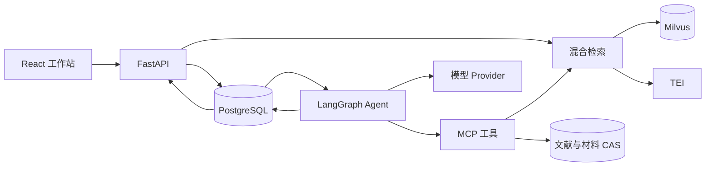

# 架构

CiteQuest 采用 Web/API、Agent 消费者和检索服务分离的结构，围绕同一任务连接搜索、证据和研究产物。

## 代码组织

| 位置 | 职责 |
| --- | --- |
| `src/citequest/web_v3` | HTTP 接口、认证与应用装配 |
| `src/citequest/agents_v3` | Agent 运行时、图编排、工具、上下文与记忆 |
| `src/citequest/research_v3` | 研究业务、结构化内容、引用与概率导航 |
| `src/citequest/search_v3`、`index_v3` | 查询、证据检索与索引管理 |
| `src/citequest/materials_v2`、`materials_v3`、`material_evidence_v3` | 上传、解析与材料证据 |
| `src/citequest/exports_v3` | 文档生成与导出 |
| `src/citequest/v2`、`data_v2`、`business_storage_v3` | 领域数据、存储与持久化 |
| `web/src` | 搜索、论文详情和科研工作站界面 |
| `deploy`、`runtime` | 部署编排、角色依赖和运行配置 |
| `assets`、`contracts`、`migrations` | 正式资源、接口协议和数据库迁移 |

运行角色分别使用对应的依赖锁：Web 位于 `runtime/s07`，Agent 位于 `runtime/s08`，解析器位于 `runtime/s04-linux`，导出组件位于 `runtime/s13`，概率服务位于 `runtime/decisionrag`。

## 服务拓扑

## 搜索与 RAG

文献正文按语义边界和 token 窗口切分，片段保留来源版本、Unicode 坐标及哈希。检索融合 BM25 与 dense 向量结果，再聚合为文献和证据窗口。

问答工作流依次解释本轮需求、检索证据、生成结构化论断并进行来源审查。服务端将引用标识解析为原文位置，界面通过证据链接展示对应窗口。追问沿用任务身份，并更新保留、新增、替换或撤销的研究要求。

可选的 `laya1` 导航在已有检索候选上进行文献级和片段级概率选择。导航记录候选、分数、入选片段及推理用量，供工作流和界面读取。

## Agent 编排

LangGraph 的节点与条件分支组织规划、工具执行、写作、审查和定向修订。PostgreSQL Saver 保存图状态；任务命令、事件和调用记录支持继续对话、过程展示与恢复。

MCP 提供检索、原文读取、选文窗口和证据核验工具。结构化模型输出交给领域控制器，控制器通过统一工具客户端执行操作。

不同业务复用同一运行底座：

- **文献问答**：需求核对、证据检索、论断写作和逐引用审查。
- **摘要与比较**：按文献执行 map/reduce，再组织原子比较和全局覆盖审查。
- **观点考证**：将用户观点拆成原子命题，按支持或反驳方向搜集证据。
- **研究计划**：围绕研究档案，衔接提纲、文献论据、方法设计、跨角色审查和章节写作。

## Context 与 Memory

每次模型调用按角色装配当前需求、研究档案、可用证据、Skill 和任务记录。规划、写作和审查使用各自的上下文投影。

任务状态通过 checkpoint 延续；项目记忆由持久 Store 管理；研究档案保存用户确认的信息与版本。对话历史提供指代上下文，引用内容由当前证据服务读取。

## 数据与部署

| 组件 | 职责 |
| --- | --- |
| PostgreSQL | 文献元数据、身份、任务、事件、档案与持久记忆 |
| Milvus / TEI | BM25、向量检索与文本编码 |
| CAS | 原文、上传材料及产物存储 |
| Web/API | 搜索、认证、任务接口与结果展示 |
| Agent worker | 消费任务命令、运行图和调用工具 |
| 概率服务 / 导出worker | 导航推理与文档转换 |

[部署配方](../deploy/core/compose.yaml)分别构建 Web 和 Agent 镜像，配置与秘密通过运行时挂载提供。安装步骤见[快速开始](quickstart.md)。
