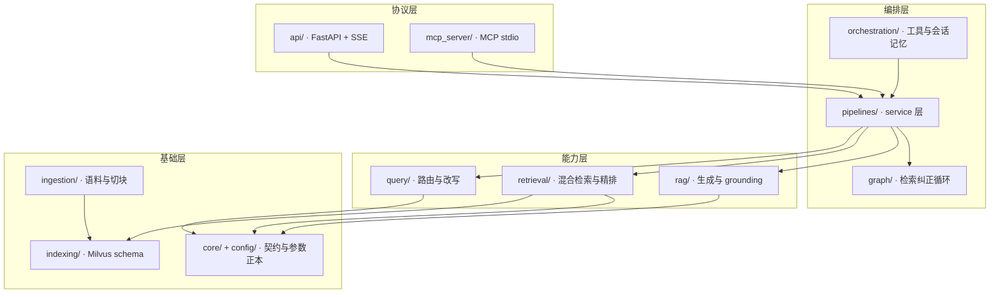

# 架构详解

本文说明 CiteQuest 的分层结构、一次请求的完整数据流，以及每一层上真正影响结果的决策与代价。
README 只给结论，本文给机制；再往下的完整论证在[设计文档](#设计文档索引)里。

## 目录

- [分层与依赖方向](#分层与依赖方向)
- [数据层：两层语料与切块](#数据层两层语料与切块)
- [索引层：一个 collection 描述两条通道](#索引层一个-collection-描述两条通道)
- [查询理解与路由](#查询理解与路由)
- [检索与融合](#检索与融合)
- [精排](#精排)
- [生成、引用与 grounding](#生成引用与-grounding)
- [流式契约](#流式契约)
- [编排：workflow 与那一条循环](#编排workflow-与那一条循环)
- [服务层与两个协议入口](#服务层与两个协议入口)
- [可观测性](#可观测性)
- [容量与扩展路径](#容量与扩展路径)
- [设计文档索引](#设计文档索引)

## 分层与依赖方向



三条依赖规则，`tests/unit` 会拦：

1. `core/` 与 `config/` 不 import 任何上层。领域契约与参数正本必须能被单独 import 到测试里，不拖起 Milvus 客户端。
2. `api/` 与 `mcp_server/` 只 import `pipelines/`。**两个协议入口共用同一份 service**，
   否则两套编排迟早静默不一致，而不一致的表现是「同一个问题在 MCP 宿主里和在网页里答案不同」——这种缺陷没人报得清楚。
3. `evaluation/` 复用生产管线，不复制检索逻辑。评测代码里另写一份检索，测的就不是线上跑的那套。

## 数据层：两层语料与切块

| 层 | 源 | 覆盖 | 每篇 chunk | 它能答什么 |
|---|---|---|---|---|
| `fulltext` | unarXive open subset（`cs.*`，2019–2022） | 5 万篇，含 section 结构 | 约 25 | 方法级、实验级问题，锚点到节与段 |
| `abstract` | OpenAlex（Computer Science，2023–2025） | 219,676 篇 | 1 | 时效性问题，锚点只到论文 |

**异质粒度是这个领域的默认状态**，不是妥协：Semantic Scholar 线上是约 1,600 万全文对 2 亿题录，
AI2 的 peS2o 用 `source` 字段区分 `s2orc` / `s2ag`。所以 `granularity` 不是补丁字段，是照抄前人的语料组织方式。

切块规则：**按 section 边界硬停**地聚合段落，目标 450 token，低于 80 token 的块并入同 section 相邻段。
不跨 section 是硬约束而非可调项——跨界的块没有唯一 section，引用锚点直接失效。
计 token 用的分词器与 dense 编码器是同一个，否则 450 token 的预算与实际编码长度对不上。

**占位符在进索引前一律删除**（`{{formula:uuid}}` / `{{cite:uuid}}`）。两条理由都是硬的：

- english analyzer 会把它们切成几十万个只出现一次的 uuid 垃圾 token，放大倒排索引，
  并污染 `avgdl` 从而扭曲每一个正常词的 BM25 分数；
- 删除而不是替换成被引论文标题——替换等于把 unarXive_citrec 的 label 泄漏进索引文本，头条基准当场作废。
  **数据处理策略是从评测口径倒推出来的**，不是先做完再找基准。

代价写在明处：放弃公式内容的可检索性。公式 LaTeX 保留在不参与检索的 metadata 字段，
是否值得由一次小样本 A/B 决定（`ab_placeholder_delete_vs_keep_latex`）。

## 索引层：一个 collection 描述两条通道

一个 Milvus collection 上声明两个 Function，写入与检索共用同一份声明：

| 字段 | 类型 | 声明 | 作用 |
|---|---|---|---|
| `dense` | `FLOAT_VECTOR(1024)` | TEI Embedding Function（`provider=TEI`） | 语义召回，HNSW / COSINE |
| `sparse` | `SPARSE_FLOAT_VECTOR` | BM25 Function（`k1=1.2`，`b=0.75`） | 词频召回，`SPARSE_INVERTED_INDEX` |
| `text_en` | `VARCHAR`，english analyzer | 挂 BM25 Function | sparse 通道的输入文本 |
| `text_exact` | `VARCHAR`，whitespace + lowercase + alphanumonly | `enable_match=True`，**不挂 BM25** | `TEXT_MATCH` / `PHRASE_MATCH` 过滤 |
| 标量 | `granularity` / `year` / `primary_category` / `license` | `year` 作 partition key | 过滤与许可标注 |

**Data-in / Data-out 的实际含义**：写入只传原文，检索只传 query 原文，
**去调 TEI 的是 Milvus 服务端而不是应用进程**。这条路线消掉了客户端编码胶水，
也就消掉了「灌库用 A 模型、查询用 B 模型」这类最难查的故障——它在结构上不可能发生。

两个连锁后果都是设计的一部分而非遗漏：客户端拿不到 query embedding，
因此 embedding 锚点路由失去了「反正本来就要算」的免费前提；embedding 缓存物理上不存在。

`text_exact` 刻意**不挂** BM25 Function：挂了它就变成第三条检索路，而融合必须保持 dense + `text_en` 两路，
RRF 的结构才不变。它只建带位置的倒排，供硬过滤与短语邻近使用。

**四项建库前不可逆**：analyzer 类型、`bm25_k1` / `bm25_b`、`text_exact` 是否存在、占位符策略。
改任何一项都是重建 collection + 重灌全量 chunk + 一次全量重编码（6–10 小时量级）。
所以它们必须在建库前用抽样定死，「先不建、评测说需要再说」在这个价格下不是省事而是赌博。
详见 [configuration.md](configuration.md) 的不可逆参数一节。

## 查询理解与路由

两级判定，不做三级级联：**规则快筛（正则 + CJK 检测 + 引号识别）→ 小 LLM 兜底**。
路由温度固定 0，因为同一条 query 两次给出不同 route 会让缓存、监控与回归测试同时失效。

四个分支：

| 分支 | 取值 | 说明 |
|---|---|---|
| 意图 | `SEARCH_ONLY` / `SEARCH_PLUS_QA` / `SEARCH_PLUS_MULTIHOP` / `STRUCTURED` | 决定是否进 RAG 路 |
| 粒度 | `fulltext_only` / `both` / `both_with_coverage_note` | **不做就会静默产生幻觉的唯一分支** |
| 语言 | 中文 query → dense 单路 | BM25 打英文文档命中率≈0，显式降级并打点，不假装 hybrid 还在工作 |
| 引号短语 | 只走 sparse 一路 + `PHRASE_MATCH` 过滤 | 单路下不存在量纲问题，BM25 分数直接就是排序 |

粒度分支值得单独说：方法级、实验级问题只有全文层答得了。不强制过滤 `granularity=fulltext`，
系统就会拿一篇 2024 年的摘要去回答方法细节，模型会顺着摘要编出一个听起来合理的损失函数。
**其余分支不做只是效果差一点，这个分支不做是错误答案。**

改写只保留两个：

- **HyDE（N=1，temperature 0.3，max_tokens 128）**。明确偏离论文默认的 N=20，代价是方差更大。
  它收约 400 ms 过路费，占 RAG 路首 token 预算的四成，因此带**存活条件**：
  必须在 citrec 库内子集与 LitSearch 上跑赢 direct，跑不赢就下线。
- **decompose（上限 4 个子问题，一次拆分不迭代）**。语料与库内引用边撑不起 self-ask 式多跳链。

已删除 multi-query（有公开负面证据：抬高召回的同时降低 retrieval precision）与 rewrite；
step-back 只进离线消融，因为抽象化会把 `RoPE` 抹成「位置编码方法」，正好杀掉 BM25 的强信号。

## 检索与融合

```
AnnSearchRequest(dense, ef 派生)  ─┐
                                   ├─ RRFRanker(k=60) ─ grouping(paper_id) ─▶ 结果
AnnSearchRequest(sparse, BM25)   ─┘
```

**查询期 `ef` 是派生的不是写死的**：`ef = max(C × group_limit × group_size, 64)`，且必须 `ef ≥ group_limit × group_size`。
写死 64 配一个更大的 limit 是真缺陷——官方默认行为就是 `ef = limit`，写死 64 反而低于默认。
搜索路（60 × 1）得 240，RAG 路（16 × 3）得 192。系数 `C` 起点取 4，**grouping 下 `ef` 官方没有任何指引**，
待组召回曲线标定，标定前只能说「我知道 `ef` 必须按 entity 预算派生」，不能给具体倍率。

**融合器唯一 `RRFRanker(k=60)`**。删除 WeightedRanker 的理由是量纲，而且有两个独立来源：

1. dense 是 COSINE（有界 `[-1,1]`），BM25 是无上界的词频累加；
2. 语料混合粒度——摘要 chunk 天然短、全文 chunk 长，BM25 的 `b=0.75` 做长度归一化，两层分数分布本就不同。

RRF 用名次替代分数，一次消掉两个来源的不可比。`k=60` 既是 Milvus 官方默认，也是 Cormack 2009 的原值，
是零辩护成本的选择；同文的敏感性数据显示 `[10,100]` 区间几乎平坦。

代价是丢掉分数幅度：两路都排第 1，一个余弦 0.99、一个 0.51，RRF 给它们相同贡献。
最疼的地方是带引号的精确短语查询——搜索路又不开 rerank，精确命中的强度无处体现。
处理方式不是把加权器加回来，而是让这类 query 根本不进融合（只发 sparse 一路）。
**单路下量纲问题不存在，所以不需要一个加权器去解决一个可以避免制造的问题。**

由此得到一条写进接口契约的硬约束：**RRF 分数无物理含义**（`k=60` 时上界约 `2/61 ≈ 0.033`），
任何上游都不许拿它做相关性阈值。响应模型里干脆没有 `rrf_score` 字段——比写文档劝阻可靠。

**chunk → paper 聚合在服务端做**，用 Milvus 原生 grouping search（`group_by_field=paper_id`）：
搜索路 60 组 × 1，RAG 路 16 组 × 3 ≤ 48 chunk。应用侧再聚合一次的做法被否掉了——
那会让分页数不准，而且必须过采样才能凑够组数。`strict_group_size` 取 `False`：
官方警告它在数据分布不均时降性能，而混合粒度语料就是典型的分布不均。

一个必须承认的连锁限制：grouping search 与 Milvus 的 Model Ranker Function **互斥**，这直接决定了下一节。

## 精排

rerank 部署在**应用侧**，模型 `BAAI/bge-reranker-v2-m3`，48 → 8，`batch_size=32`（两批前向），fp16。
两个官方能力互斥时选 grouping，因为论文级聚合是产品必需，而 rerank 放哪一层是实现细节。

分数契约：内部是 raw logit，**对外统一 `normalize=True`（sigmoid → [0,1]）**。
统一口径的理由很具体：0.3 这个阈值按 sigmoid 反推约等于 logit −0.85，
等于把模型判为倾向不相关的 chunk 计为有效证据。

**阈值不拍数，默认 `None`（不过滤）**。标定流程照 Cohere 的官方做法：
30–50 条代表性 query → 标出临界相关文档 → 过 reranker 取分 → 取均值。
阈值绑模型版本，换模型必须重标并记版本号（`calibrated_for_model_version`）。

搜索路不开 rerank。连带后果必须主动承认：**RAG 路的指标不能给搜索质量背书。**

## 生成、引用与 grounding

context 组装：≤48 chunk → rerank → 8 条。**prompt 里逐块标注 `granularity`**，
否则模型会把摘要当方法细节来编——这是生成层唯一「不做就静默产生幻觉」的开关。

引用锚点是四元组 `(paper_id, section, sec_number, paragraph_idx)`。
摘要层只有 `paper_id`，其余三项为 `None`——**不伪造段落级定位**。
显示一个不存在的「3.2 节」比不显示更糟：用户拿着它去原文里找不到，就会认定整套引用都不可信。

grounding 分三层：

| 层 | 手段 | 能否拦截 |
|---|---|---|
| 确定性硬校验 | `[N]` 越界、引用全部非法 | **能**。字符串校验，误判率结构性为零 |
| 在线软信号 | HHEM-2.1-Open，**只在首句跑一次** | 不能，只降级 |
| 离线回归 | MiniCheck + ALCE citation precision/recall + RAGAS faithfulness | 不进在线路径 |

判定沿**已声明的 `[N]` 引用边**逐边进行，不再对全部 chunk 取最大相似度——
embedding 余弦测的是语义接近，不测逻辑蕴含。

在线只跑一次 HHEM 的必要性判据很直接：**花在线延迟买一个不敢用来拦截的软信号，不过关**。
HHEM 自报 F1 在 44.8–66.8 区间，只能当软信号；且仅支持英文，中文回答只做确定性引用校验。
逐句在线判定是一个默认关闭的开关。阈值待标定，未标定时一律 `unverified`——
**`unverified` 不是失败，它是诚实取值**，比拿旧阈值冒充标定结果好。

## 流式契约

原始需求里同时写着「逐 token 推送」与「不合格不展示」，这两条**物理上不可同时成立**——token 出网就收不回来。
解法是把「不展示」收缩到唯一可执行的时刻：第一个 token 出网之前。

```
event: meta            立刻发，先于一切下游调用（同时是「代理没有缓冲」的探针）
event: search_results  检索路完成，用户已经有东西看了；AI 区域显示骨架屏
   ├─ 过闸  → ai_answer_start → ai_answer_delta(seq=1) → …
   └─ 不过闸 → ai_answer_error{insufficient_evidence}   一个 token 都没推
event: ai_answer_done  下发逐引用的支持强度
event: done
```

三条不变量：

1. `meta` 永远是第一个事件；
2. `ai_answer_start` 出现即意味着首句已过闸；
3. `ai_answer_flagged` 只能降级不能撤回——它永远指向一个**已经推送出去**的 `seq`，
   类型上就看得出来：有 `seq` 字段，没有任何「删除」或「替换」字段。

**推送单位必须等于校验单位**，所以按句边界推送而不是按 token 或按定时攒批：
半句话出网时它还没法校验，校验结果没有地方落地。句子是 grounding 的自然最小单位，
这一点有两个独立来源（MiniCheck 的 API 本身就是句子级；Anthropic Citations API 默认按句切块且不引用小于一句的片段），
两者都不是为了迁就流式。

整条 SSE 流永远是 HTTP 200：首帧一旦发出，状态码已经写进响应行，物理上改不了。
所以「检索成功但生成失败」只能是 200 + `ai_answer_error`，前端隐藏 AI 区域、保留搜索结果。
**搜索结果是底线，AI 回答是增强**——AI 路超限时静默降级而不是返回 429。

## 编排：workflow 与那一条循环

主体是 **workflow（routing + parallelization）**，控制流写死在代码里。
全系统只有一处由模型决定下一步：`graph/correction_loop.py`。

```
START ──▶ grade ──(Correct | 达到上限 | 无进展 | 超时)──▶ END
            │
            └─(Ambiguous | Incorrect)──▶ rewrite ──▶ retrieve ──▶ grade（回环）
```

三条护栏全是**代码级硬约束**，不依赖模型配合——这正是选 LangGraph 而不是自由 ReAct 的核心理由：
自由 ReAct 的轮数与 token 上限只能靠 prompt 请模型自觉，而 `recursion_limit` 是框架强制的。

- `recursion_limit=8`：**显式设置**。官方默认是 1000，离安全边界差两个数量级。
  8 的来源是循环体的步数上界（1 轮纠正 = grade + rewrite + retrieve + grade = 4 步，留一倍余量），
  多出来的余量用来吸收框架自身的记账步，不是用来多跑一轮——多跑一轮由 `max_correction_rounds=1` 挡住，两道闸各管各的。
- 超时 5 s，**超时退回首轮结果不报错**。
- 连续 2 轮新增有效 chunk 为 0 即止损。

止损判据事先写死：纠正循环相对静态 pipeline 提升 < 5% → 砍掉循环，只保留工具化与 MCP。
`CorrectionOutcome` 带出 `triggered` 与 `rounds` 就是为了让这个 5% 可判。

checkpointer 默认是进程内的，因此**不声称具备持久化能力**；会话记忆（`orchestration/memory.py`）
只做研究会话（主键 `research_id`，跟课题走），**不做用户画像记忆**（跟人走），且 v1 默认关闭。

## 服务层与两个协议入口

`pipelines/` 是协议无关的 service 层，`api/` 与 `mcp_server/` 都是它的 adapter。
叙事必须是「检索能力做成了协议无关的 service 层，MCP 是其中一个 adapter」，
而不是「做了一个 MCP server」——区别不是措辞，是可验证的结构差异。

MCP 侧的配额换了维度：stdio 是本地进程，没有 IP 概念，令牌桶的 key 维度不成立。
所以配额换成两条——单会话调用次数上限，以及**按 token 而不是按次数计的预算**
（一次 `search_chunks` 返回的文本 token 成本远高于一次 `get_paper_detail`）。

工程护栏（默认值见 [configuration.md](configuration.md)）：

- **GPU 信号量各类不共享额度**。共享额度会让秒级的生成任务饿死几十毫秒的编码任务。
- **队列一律有界**。无界队列在过载时把所有人的延迟无限拉长，且监控上表现为延迟缓升而非错误率跳变——最难发现的一类过载。
- **排队超时必须短于该阶段的价值窗口**。生成排队 2 s 之后即使拿到额度，也必破 2.5 s 的首 token 预算，那份等待是纯浪费。
- **单次超时 = 该阶段 p95 预算 × 2**，向上取到易记刻度。卡在 p95 附近的超时会在正常波动时就大面积降级。
- **deadline 逐层传递**（入口算绝对截止时间戳）。否则「每层 2 s」在四层链路上累积成 8 s。
- **超时语义全系统只有一种**：已产生内容一律保留、不足部分标注；不因超时丢弃已生成内容，不用断连表达超时。
  两种语义会让前端无法写出一致的状态机。

默认单 worker：并发闸门与 GPU 信号量是进程内状态，多 worker 会让「rerank 并发 4」实际变成 4 × worker 数，
把显存账直接打穿。要扩容就起多个容器，让闸门额度随实例数拆分。

## 可观测性

结构化日志（structlog）+ Prometheus 指标 + 逐请求 `request_id` 注入 + span 记录。
三个**静默失败**监控项，它们的共同特征是「不报错，指标悄悄下滑」：

1. `group_count` 与请求组数的比值——凑不满组时不会报错，只会返回更少的组；
2. `degraded` 非空的请求占比——降级如果不可观测，线上会长期跑在降级状态而所有健康检查都是绿的；
3. `retrieval_mode=dense_only` 的占比——把中文 query 的降级度量出来，而不是等有人抱怨才去查。

`prompt_version` 进日志与 span：改 prompt 不改版本号，线上指标变动就无法归因。

## 容量与扩展路径

当前规模的内存账：147 万 × 1024 维 × 4 B ≈ **6.02 GB** 原始向量，
加 HNSW 图约 0.44 GB（按论文 60–450 B/对象，`M=32` 取约 300 B），合计约 **6.5 GB**，32 GB 单机宽裕。

**×10（1,470 万 chunk）→ 约 60 GB 原始向量，单机内存放不下。这是第一个瓶颈的确切位置。**
对应的官方手段按代价从小到大：

| 档 | 手段 | 代价 |
|---|---|---|
| ① | mmap | 零召回损失；HNSW 降级可接受而 IVF 系列严重下降；与 DiskANN 互斥 |
| ② | HNSW_SQ，**强制 `refine=true`** | `refine_type` 精度须高于 `sq_type`，否则召回掉幅不可接受 |
| ③ | DiskANN + NVMe | 换硬件，与 mmap 互斥 |

其余四个瓶颈与手段：召回随 N 退化（用 FLAT 暴力算 ground truth，固定 recall 扫 `ef` 画 recall-QPS 曲线）；
带过滤检索（`year` 作 partition key 物理分区）；构建吞吐（真瓶颈在 GPU 不在数据库写入，
用长度分桶排序减 padding、bulk import 而非逐条 insert）；sparse 侧倒排规模（占位符清理是前提条件）。

**这一节的用途不是声称能处理更大规模**，而是给「哪些参数必须建库前定死」定价：
那四项不可逆参数一旦要改，就是一次 6–10 小时的全量重灌。

## 设计文档索引

完整设计文档共 9 份，与本仓库并列存放于 `项目介绍/`（不随代码分发）。
每份都比本文更深，按模块划分：

| 文档 | 内容 |
|---|---|
| [00_项目总览与架构](../../项目介绍/00_项目总览与架构.md) | 系统全景、模块划分 M1–M8、端到端数据流 |
| [01_数据层_语料构建与切块](../../项目介绍/01_数据层_语料构建与切块.md) | 两层语料的获取、清洗、对齐、切块与数据质量监控 |
| [02_索引与混合检索](../../项目介绍/02_索引与混合检索.md) | collection schema、两个 Function、HNSW 与 `ef` 派生、RRF、grouping |
| [03_查询理解与路由](../../项目介绍/03_查询理解与路由.md) | 两级路由、四个分支、HyDE 与 decompose 的取舍 |
| [04_RAG生成与引用可信](../../项目介绍/04_RAG生成与引用可信.md) | context 组装、引用锚点、grounding 三层、流式契约 |
| [05_Agent编排与会话记忆](../../项目介绍/05_Agent编排与会话记忆.md) | workflow 与循环的边界、工具设计、研究会话记忆 |
| [06_服务层与工程化](../../项目介绍/06_服务层与工程化.md) | API 契约、缓存、限流、并发闸门、超时与降级 |
| [07_评估与可观测](../../项目介绍/07_评估与可观测.md) | 三层评测体系、口径纪律、显著性检验、可观测项 |
| [08_参数正本表与设计边界](../../项目介绍/08_参数正本表与设计边界.md) | 全部参数的取值、依据与出处；已剔除方案清单 |

仓库内的落地说明见 [configuration.md](configuration.md)（配置项）与 [development.md](development.md)（开发与扩展）。
